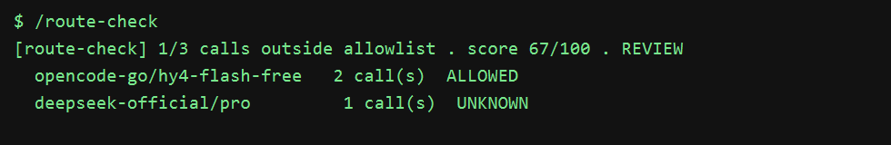

# dsh-plugin-safe-route

**One command tells you which models your DSH session actually used — and flags any route outside your allowlist.**

Cost/context plugins *display* spending after the fact. `safe-route` *judges* the route against a policy you control, so a paid-model slip is visible in one keystroke. It is read-only: it reads provider/model names from session events, never prompts, tool bodies, or file contents, and it makes no network calls.

## Install

```powershell
dsh plugin add dsh-plugin-safe-route
```

Requires Node `^22.19.0 || >=24` and DSH `>=0.2.0-rc.2 <0.3.0`.

## 30-second demo

1. Use DSH normally for a few turns.
2. In any session, type `/route-check`.
3. You get a compact scorecard:

```text
[route-check] 1/3 calls outside allowlist · score 67/100 · REVIEW
  opencode-go/hy4-flash-free         2 call(s)  ALLOWED
  deepseek-official/deepseek-v4-pro  1 call(s)  UNKNOWN
Fix: switch the default model to an allowed route, or update the allowlist in cordis.patch.yml.
```

Use `/route-check --json` for machine-readable output (CI, scripts, dashboards).

## Configuration

The bundle patch seeds an allowlist of free routes. Edit the row in your profile's `cordis.patch.yml` to change it:

```yaml
- id: dsh-plugin-safe-route
  name: dsh-plugin-safe-route
  config:
    policy:
      allow:
        - provider: opencode-go
          model: hy4-flash-free
        - provider: opencode-go
          model: longcat-2.5-free
      deny:
        - provider: opencode-go
          model: hy4            # paid sibling — flag explicitly
```

| Key | Type | Default | Meaning |
|---|---|---|---|
| `policy.allow` | `{provider, model?}[]` | the two free `opencode-go` routes | Routes counted as `ALLOWED`. Omit `model` (or use `*`) to match the whole provider. |
| `policy.deny` | `{provider, model?}[]` | `[]` | Routes counted as `DENIED`. Deny wins over allow. |

An invalid or empty `allow` falls back to the default free-route list, so a typo cannot silently disable the check.

## Scoring

`score = round(100 × allowed calls / all observed model calls)`. An empty session scores 100.
`verdict` is `clean` (no out-of-policy routes), `review` (some `unknown`), or `violation` (any `denied`).

## Privacy & safety

- Only `provider` and `model` strings are read from `request/header` and `request/context` events.
- No prompt, reasoning, tool result, file, or credential is read or stored.
- No network calls, no telemetry, no file writes.
- Report text is passed through a redaction filter before display.

## Compatibility

| Component | Supported |
|---|---|
| DSH | `>=0.2.0-rc.2 <0.3.0` |
| Node | `^22.19.0 \|\| >=24.0.0` |
| Cordis | `>=4.0.0 <5` |
| Surface | headless and web (command registry only) |

## Troubleshooting

| Symptom | Cause | Fix |
|---|---|---|
| `/route-check` not found | Bundle row not installed | Re-run `dsh plugin add dsh-plugin-safe-route`, then restart DSH. |
| Score is 100 but I used a paid model | The route isn't in `allow` or `deny` | Add an explicit deny rule for it. |
| `no model calls observed` | No `request/*` events in this session yet | Use the session once, then re-run. |
| Wrong allowlist | Profile `cordis.patch.yml` overrides the bundle row | The last write wins — edit the profile row, not the package. |

## Development

```powershell
npm install
npm test
npm pack --dry-run
```

Tests are fully offline: synthetic event fixtures, no model or network calls.

## License

[MIT](LICENSE)


## Demo




## Listed in

- [awesome-ai-plugins — DeepSeek Harness Plugins](https://github.com/hashgraph-online/awesome-ai-plugins#deepseek-harness-plugins) (security scan passed).

## Related plugins

- [dsh-plugin-session-archive](https://github.com/SSHOOTING/dsh-plugin-session-archive)
- [dsh-plugin-token-budget](https://github.com/SSHOOTING/dsh-plugin-token-budget)
- [dsh-plugin-mcp-guard](https://github.com/SSHOOTING/dsh-plugin-mcp-guard)
- [dsh-plugin-free-model-advisor](https://github.com/SSHOOTING/dsh-plugin-free-model-advisor)
