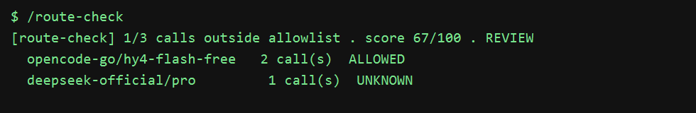

# dsh-plugin-safe-route

**一条命令看清这次 DSH 会话到底用了哪些模型，并把不在白名单里的路由标出来。**

成本/上下文类插件是「事后显示花了多少」；`safe-route` 是「按你定的策略判定路由是否越界」，一次按键就能发现误用付费模型。它只读：从会话事件里取 provider/model 名称，不读提示词、工具结果或文件内容，也不发起任何网络请求。

## 安装

```powershell
dsh plugin add dsh-plugin-safe-route
```

要求 Node `^22.19.0 || >=24`，DSH `>=0.2.0-rc.2 <0.3.0`。

## 30 秒演示

1. 像平时一样用 DSH 聊几轮。
2. 任意会话里输入 `/route-check`。
3. 得到一张精简评分卡：

```text
[route-check] 1/3 calls outside allowlist · score 67/100 · REVIEW
  opencode-go/hy4-flash-free         2 call(s)  ALLOWED
  deepseek-official/deepseek-v4-pro  1 call(s)  UNKNOWN
Fix: switch the default model to an allowed route, or update the allowlist in cordis.patch.yml.
```

`/route-check --json` 输出机器可读结果，可用于脚本/CI/看板。

## 配置

bundle patch 默认放行两条免费路由。在你的 profile `cordis.patch.yml` 里改这一行即可：

```yaml
- id: dsh-plugin-safe-route
  name: dsh-plugin-safe-route
  config:
    policy:
      allow:
        - provider: opencode-go
          model: hy4-flash-free
        - provider: opencode-go
          model: longcat-2.5-free
      deny:
        - provider: opencode-go
          model: hy4            # 付费的兄弟模型，显式标记
```

| 字段 | 类型 | 默认值 | 含义 |
|---|---|---|---|
| `policy.allow` | `{provider, model?}[]` | 两条 `opencode-go` 免费路由 | 判为 `ALLOWED` 的路由。省略 `model`（或写 `*`）表示整个 provider。 |
| `policy.deny` | `{provider, model?}[]` | `[]` | 判为 `DENIED` 的路由。deny 优先于 allow。 |

`allow` 为空或格式非法时会回退到默认免费路由，因此写错配置不会让检查失效。

## 计分规则

`score = round(100 × 放行调用数 / 观察到的模型调用数)`。空会话记 100 分。
`verdict` 有三种：`clean`（全部合规）、`review`（存在 `unknown`）、`violation`（存在 `denied`）。

## 隐私与安全

- 只从 `request/header` 和 `request/context` 事件读取 `provider`、`model` 两个字符串。
- 不读取、不保存提示词、推理内容、工具结果、文件或凭据。
- 不发网络请求、不上报、不写文件。
- 输出前经过脱敏过滤。

## 兼容性

| 组件 | 支持范围 |
|---|---|
| DSH | `>=0.2.0-rc.2 <0.3.0` |
| Node | `^22.19.0 \|\| >=24.0.0` |
| Cordis | `>=4.0.0 <5` |
| 界面 | headless 与 web（只用命令注册表） |

## 故障排查

| 现象 | 原因 | 处理 |
|---|---|---|
| 找不到 `/route-check` | bundle 行未安装 | 重跑 `dsh plugin add dsh-plugin-safe-route`，重启 DSH。 |
| 用了付费模型但满分 | 该路由不在 `allow`/`deny` 中 | 加一条显式 deny 规则。 |
| 提示 `no model calls observed` | 本会话还没有 `request/*` 事件 | 先用几轮，再执行。 |
| 白名单不生效 | profile 的 `cordis.patch.yml` 覆盖了 bundle 行 | 后写者胜；改 profile 里的那一行。 |

## 开发

```powershell
npm install
npm test
npm pack --dry-run
```

测试完全离线：合成事件夹具，不调用模型、不联网。

## 许可证

[MIT](LICENSE)


## 收录于

- [awesome-ai-plugins — DeepSeek Harness Plugins](https://github.com/hashgraph-online/awesome-ai-plugins#deepseek-harness-plugins)（安全扫描通过）。

## 相关插件

- [dsh-plugin-session-archive](https://github.com/SSHOOTING/dsh-plugin-session-archive)
- [dsh-plugin-token-budget](https://github.com/SSHOOTING/dsh-plugin-token-budget)
- [dsh-plugin-mcp-guard](https://github.com/SSHOOTING/dsh-plugin-mcp-guard)
- [dsh-plugin-free-model-advisor](https://github.com/SSHOOTING/dsh-plugin-free-model-advisor)
## Demo


